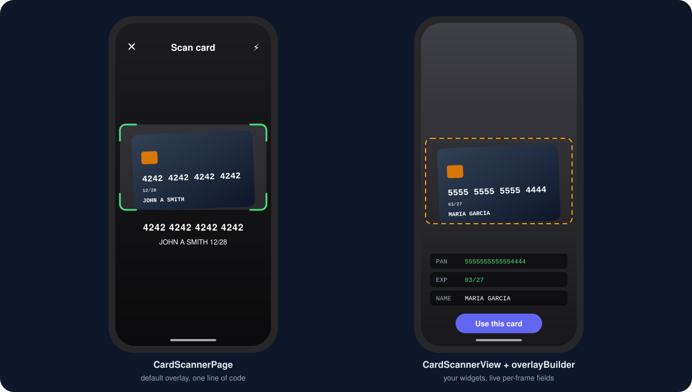
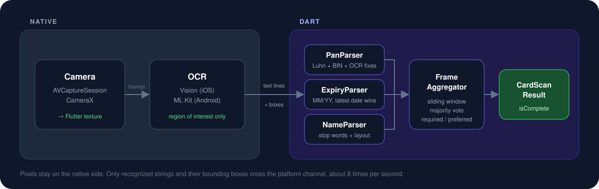

<p align="center">
  
</p>

<p align="center">
  <a href="https://pub.dev/packages/flutter_card_scanner_plus"></a>
  <a href="https://github.com/PopovVA/flutter_card_scanner_plus/actions/workflows/ci.yml"></a>
  <a href="https://github.com/PopovVA/flutter_card_scanner_plus/blob/main/LICENSE"></a>
  
  <a href="https://buymeacoffee.com/LeonRedfield"></a>
</p>

Scan a payment card with the camera and get its number, expiry date and cardholder name back as a typed result. Recognition runs fully on the device using the platform OCR engines: Vision on iOS, ML Kit on Android, and PaddleOCR on WebGPU or WebAssembly in a browser. There is no third party camera plugin, no cloud service and no network access.

Supported networks: **Visa**, **Mastercard**, **American Express**, **Discover**, **JCB**, **Diners Club**, **UnionPay**.

Platforms: **iOS**, **Android** and **web**.

## Highlights

- **One line integration.** `CardScannerPage.show(context)` opens a ready screen and returns a `CardScanResult`.
- **Bring your own UI.** `CardScannerView` renders the camera preview and lets you draw anything on top with `overlayBuilder`.
- **Robust recognition.** Luhn check, BIN detection, repair of common OCR confusions (`O` vs `0`, `I` vs `1`, `S` vs `5`), and multi frame voting so a single misread never leaks into the result.
- **Configurable fields.** Decide which fields are required, which are nice to have, and how long to wait for them.
- **Static images too.** `CardScanner.scanImage(bytes)` recognizes a card in a photo from the gallery.
- **Privacy by design.** Frames never leave the native layer. Only recognized strings and bounding boxes cross the platform channel. `toString()` on results masks the number.

<p align="center">
  
</p>

## Install

```bash
flutter pub add flutter_card_scanner_plus
```

### iOS

Add a camera usage description to `ios/Runner/Info.plist`:

```xml
<key>NSCameraUsageDescription</key>
<string>The camera is used to scan your payment card.</string>
```

Minimum deployment target is iOS 15.

### Android

Nothing to configure. The plugin declares the `CAMERA` permission and requests it at runtime. Minimum SDK is 24 (Android 7.0). The ML Kit text recognition model is bundled with the app, so scanning works offline and does not depend on Google Play Services being up to date.

## Quick start

```dart
import 'package:flutter_card_scanner_plus/flutter_card_scanner_plus.dart';

final card = await CardScannerPage.show(context);
if (card != null) {
  print(card.formattedNumber);   // 4242 4242 4242 4242
  print(card.brand);             // CardBrand.visa
  print(card.formattedExpiry);   // 12/28
  print(card.cardholderName);    // JOHN A SMITH (may be null)
}
```

`CardScannerPage` shows a full screen scanner with a card shaped frame, a torch toggle and a close button. It pops with the result as soon as the scan is complete, or with `null` if the user dismisses it.

## Custom UI

Use `CardScannerController` and `CardScannerView` when the default page does not fit your design. The controller is a `ValueNotifier<CardScannerState>`, so it works with `ValueListenableBuilder` or any state management you already use.

```dart
class ScanScreen extends StatefulWidget {
  const ScanScreen({super.key});

  @override
  State<ScanScreen> createState() => _ScanScreenState();
}

class _ScanScreenState extends State<ScanScreen> {
  final _controller = CardScannerController();

  @override
  void dispose() {
    _controller.dispose();
    super.dispose();
  }

  @override
  Widget build(BuildContext context) {
    return CardScannerView(
      controller: _controller,
      overlayBuilder: (context, state, cardRect) {
        // cardRect is where the card frame sits, in this widget's coordinates.
        return Stack(
          children: [
            Positioned.fromRect(
              rect: cardRect,
              child: DecoratedBox(
                decoration: BoxDecoration(
                  border: Border.all(
                    color: state.isComplete ? Colors.green : Colors.white,
                    width: 2,
                  ),
                  borderRadius: BorderRadius.circular(12),
                ),
              ),
            ),
            if (state.result.hasNumber)
              Positioned(
                left: 0,
                right: 0,
                top: cardRect.bottom + 24,
                child: Text(
                  state.result.formattedNumber!,
                  textAlign: TextAlign.center,
                  style: const TextStyle(color: Colors.white, fontSize: 22),
                ),
              ),
          ],
        );
      },
    );
  }
}
```

`CardScannerState` gives you everything needed for live feedback:

| Field | What it is |
|---|---|
| `result` | Aggregated `CardScanResult`, updated as fields get confirmed |
| `lastFrame` | Raw candidates from the most recent OCR frame, useful for "live" highlighting |
| `isRunning`, `torchEnabled`, `error` | Camera state |

The view keeps the OCR region of interest in sync with the card frame automatically, so text outside the frame is ignored.

### One shot scanning

```dart
final controller = CardScannerController();
final card = await controller.scanOnce(); // starts the camera, completes when done
```

### Reusing the default overlay

`CardFrameOverlay` is exported, so you can place it inside your own builder and add controls around it:

```dart
overlayBuilder: (context, state, cardRect) => Stack(
  children: [
    CardFrameOverlay(state: state, cardRect: cardRect, hint: 'Hold steady'),
    Positioned(bottom: 40, left: 0, right: 0, child: MyCancelButton()),
  ],
),
```

## Your own preview

`CardScannerView` gets the preview from the platform, so what a preview is can differ per platform: a texture on iOS and Android, an element on the web. If you draw your own camera UI around a bare controller, ask the controller for it:

```dart
final camera = controller.value.camera;
if (camera != null) ClipRect(child: controller.buildPreview(camera))
```

Give it the whole area your guide is drawn over, and nothing else. The preview fills that area the way `BoxFit.cover` would, each platform in its own way, and the region of interest is computed for exactly that. Scaling it yourself reads a different part of the frame than the one under your guide, and on the web it does not work at all: Flutter will not scale a platform view with a widget.

## Frame size

The frame is the largest ISO sized rectangle that fits every limit: `frameWidthFraction` of the view width (0.88), `frameHeightFraction` of its height (0.6), and `maxFrameWidth` logical pixels (440).

The absolute limit is what a tablet needs. A fraction of the width is the wrong measure on a big screen: 88% of an iPad is wider than a card held at a comfortable distance, so the card has to be pressed against the lens to fill the frame. A card is about the same size in everyone's hand.

```dart
CardScannerView(
  controller: controller,
  maxFrameWidth: 520, // roomier frame on tablets
)
```

## Choosing which fields you need

`ScanRequirements` controls when a scan is considered complete.

```dart
CardScannerPage.show(
  context,
  requirements: const ScanRequirements(
    required: {CardField.number, CardField.expiry}, // wait for these
    preferred: {CardField.name},                    // wait, then skip
    preferredTimeout: Duration(milliseconds: 1500),
    preferredGrace: Duration(seconds: 5),           // if one is mid-confirm
  ),
);
```

| Preset | Required | Preferred | Use when |
|---|---|---|---|
| `standard` | number, expiry | name | Default. Fast, and the name is included when it is legible. |
| `numberOnly` | number | none | You only need the PAN. |
| `full` | number, expiry, name | none | The name is mandatory. Waits until it is recognized. |
| `fast` | number, expiry | none | Demos and tests. Accepts the first Luhn valid frame. |
| `twoSided` | number, expiry | name | The name is printed on the other side. Waits 15 s for it. |

The number is always required. A field that is neither required nor preferred is still filled in when it happens to be recognized, but never delays completion.

`preferredTimeout` is measured from the frames themselves, not the wall clock, so a scan that sits in the background does not time out while nothing is being recognized. When the timeout runs out while a preferred field already has votes, `preferredGrace` buys it a little more time instead of throwing the half-recognized value away.

### Cards with the name on the back

A confirmed field is kept. Frames that recognize nothing, which is every frame while a card is being turned over, cannot take it away, and only a different number confirmed with more votes than the current one starts a new card. That is what lets number and expiry be read from one side and the name from the other:

```dart
final card = await CardScannerPage.show(
  context,
  requirements: ScanRequirements.twoSided,
);
```

`CardScannerState.confirming` lists the fields that have a candidate but not yet enough agreement between frames, which is what to show as progress rather than as a result.

### Your own rules

`ScanSession` is the interface the controller drives. Implement it to change how frames become a result without touching the camera pipeline:

```dart
final controller = CardScannerController(session: MyOwnSession());
```

## Given and family name

Cards print one line and never say where the surname starts, so a payment form that wants two fields has to guess. `CardholderName` guesses the usual way: the first word is always the given name, the last word is the surname, and a particle in front of the surname or a generational suffix after it belongs to it.

```dart
final name = result.splitName;       // null when no name was recognized
name?.given;   // MARIA
name?.family;  // DE LA CRUZ
```

It handles middle names and initials ("WREN A. NGUYEN"), the suffixes JR, SR, II, III and IV ("JOHN SMITH JR" splits as JOHN and SMITH JR), and the particles da, das, de, del, della, den, der, di, do, dos, du, la, le, van and von. The first word is never taken as a particle, because DEL, LE and DU are given names as often as they are particles and a card always prints one. It will get some names wrong, so let people correct it.

## Text, prompts and failures

The built-in page tells the user what it is still looking for, shows a spinner while it works, and offers a way out when the camera will not open.

```dart
CardScannerPage.show(
  context,
  strings: CardScannerStrings(
    alignCard: l10n.alignCard,
    lookingForName: l10n.turnTheCardOver,
    permissionDenied: l10n.cameraAccessNeeded,
    // every string has an English default
  ),
  onOpenSettings: openAppSettings, // from permission_handler, if you use it
  enableHaptics: true,             // one light tap per prompt, off by default
);
```

`CardScannerStrings` holds every string the scanner can show, with English defaults. `onOpenSettings` is a callback rather than a dependency, so this package does not pull a permissions plugin into your app; leave it out and no such button is offered. The close button is always reachable, including on the error screen.

A failure reaches a custom UI as a `CardScannerException` in `CardScannerState.error`, with a `code`. Most are about the camera. One is not: `CardScannerException.tooSlow` means a browser that cannot scan right now however long it is given, and the right answer to it is a form. See [iOS 27](#ios-27-when-webassembly-runs-slowly).

## The web

The scanner runs in a browser too. Same frame, same voting, same parser;
a different camera and a different OCR engine underneath.

### Install the engine

The browser has no system OCR, so the package brings its own: PaddleOCR
PP-OCRv4 in a Web Worker. The models, two builds of the ONNX runtime and
OpenCV come to about 51 MB, which is why they are not package assets.
Every iOS and Android build would carry them for nothing. A browser
fetches less than that: 41 MB where it has WebGPU, 33 MB where it does
not, once, and then from its cache.

Run this once per app, from the app's root:

```bash
dart run flutter_card_scanner_plus:install_web
```

It writes `web/flutter_card_scanner_plus/`, fetching each file from npm at
a pinned version and checking it against a pinned hash. Add that folder to
`.gitignore` and run the command in CI rather than committing 51 MB.

Run it again whenever you upgrade the package. The worker scripts ship
inside the package and are copied from it, so an app upgraded without its
engine folder serves the old workers to the new scanner. The scanner
notices and reports `ocrUnavailable` at once, with a message that says
so.

It needs `npm` and `tar` on `PATH`. OpenCV is also split on the way in:
its script ships with a 7.5 MB WebAssembly binary inlined as a 10 MB
base64 `data:` URI, and parsing that string costs tens of megabytes of
JavaScript heap. The installer writes the binary as `opencv.wasm` and
points the script at it.

### Two engines: WebGPU first, WebAssembly behind it

The installer writes two workers built from the same sources. They run the
same pipeline and return the same lines; they differ in where the two
models execute.

| Worker | Models run | Runtime it fetches |
|---|---|---|
| `card_ocr_worker_webgpu.js` | on the GPU | `ort-wasm-simd.jsep.wasm`, 18 MB |
| `card_ocr_worker.js` | in WebAssembly, one thread | `ort-wasm-simd.wasm`, 11 MB |

The scanner starts the WebGPU worker when the page has `navigator.gpu`,
and the WebAssembly worker otherwise. Loading is a step of its own, apart
from reading frames, so a WebGPU engine that will not load is not mistaken
for a frame that failed: the scanner terminates that worker, starts the
WebAssembly one, and stays with it for as long as the page lives. You do
nothing; there is no setting.

The WebGPU worker fails its load, and so hands over, when

- its file is missing,
- the browser has WebGPU on the page but not in a worker,
- the browser has no adapter to give, or
- the only adapter is a software one. That one would load and read cards
  correctly at forty seconds a frame, measured in headless Chromium on
  SwiftShader, where WebAssembly takes one.

Only the model graphs are on the GPU. OpenCV, the pixel work around the
models and the rest of the runtime stay in WebAssembly either way.

Seconds per frame, on real iPhones with real cards and in desktop Chrome
with a drawn one. The numbers come from the production web app that
reported the iOS 27 problem, which runs these models on this runtime:

| Engine | iPhone | iPhone in the [iOS 27 slow state](#ios-27-when-webassembly-runs-slowly) | Desktop Chrome |
|---|---|---|---|
| WebGPU | 0.31 to 0.36 | 0.73 to 1.18 | 0.1 to 0.2 |
| WebAssembly | 0.65 to 0.75 | 7 to 20, or never | about 1.5 |

To see which one your users get, listen:

```dart
CardScanner.engineReports.listen((report) {
  analytics.log('card_scanner_engine', {
    'backend': report.backend.name,                   // webGpu or wasm
    'loadMs': report.loadTime?.inMilliseconds,        // null if it never loaded
    'benchmarkMs': report.benchmark?.inMilliseconds,  // WebAssembly only
    'tooSlow': report.tooSlow,
    'webGpuFailure': report.webGpuFailure,            // why WebGPU was passed over
  });
});
```

One report per load, with no card data in it. `CardScanner.lastEngineReport`
holds the latest. Neither says anything on iOS or Android.

What has not been checked, so that you know to: WebGPU on iOS 26 and on
Android Chrome, and how much memory the WebGPU engine takes in iOS WebKit.
Its runtime alone is 8 MB bigger.

### iOS 27, when WebAssembly runs slowly

Some iOS 27 Safari processes run WebAssembly about fifteen times slower
than normal, as if without their optimizing compilers. Seen on iPhones
with iOS 27.2; the simulators do not show it. The cause is not known.
Reloading the page keeps the state. Restarting Safari cleared it.

Nothing fails, which is the trouble. The camera opens, the engine loads,
and then a frame takes 7 to 20 seconds instead of under one. A frame that
finishes inside its 20 second limit counts as a success, so a scan could
run for minutes without reading the card or giving up.

Two things stand between that and your user.

**WebGPU avoids it.** The models are the slow part, and on the GPU they
are not in WebAssembly at all. The same phones in the same state read
cards at about a second a frame there. An iPhone with iOS 27 has WebGPU,
so this is the path it takes without being asked.

**Where there is only WebAssembly, the scanner says so at once.** Before
it sends a frame, the worker times a 66 byte WebAssembly loop, five
million steps, fastest of three runs. That takes 4 to 15 ms on an iPhone
normally and 55 to 87 ms in the slow state. Above 40 ms the scanner frees
the engine and reports `CardScannerException.tooSlow` instead of scanning.
It asks before the engine is fetched, so a browser in that state does not
download 33 MB to throw away, and again once it has loaded, because after
the load is where the state was actually measured.

`CardScannerPage` shows `CardScannerStrings.tooSlow`, which by default
tells the person to enter the card by hand. With your own UI, send them
to your form:

```dart
controller.addListener(() {
  if (controller.value.error?.code == CardScannerException.tooSlow) {
    showManualEntry();
  }
});
```

Trying again on the same page will usually say the same. The check is
skipped on WebGPU, where it would be measuring the wrong thing.

### Memory, which is the whole story on iPhone

The engine takes **300 to 500 MB** in iOS WebKit, and iOS kills a tab that
passes about 2 GB. Measured in the iOS Simulator, loading the engine peaks
around 258 MB and one 960 pixel frame peaks around 330 MB. Stopping the
scanner terminates the worker and gives it all back.

That matters because Flutter's own CanvasKit renderer is heavy in iOS
Safari ([flutter/flutter#152709](https://github.com/flutter/flutter/issues/152709)),
and since Flutter 3.29 there is no HTML renderer to fall back to. A host
page already holding 1 GB has no headroom, and the tab dies while the
engine loads, with nothing in the console and a bare reload to show for it.

So: test the scanner inside your real app on a real iPhone, not only in
the example. If the page is heavy, free what you can before opening the
scanner, and close the scanner as soon as it has the card.

### Why ONNX Runtime is pinned

`onnxruntime-web` is pinned to **1.18.0**. The WebAssembly worker imports
its `wasm-core` entry point and the WebGPU worker its `webgpu` one; both
load a single-threaded runtime. 1.19 and later ship only a threaded
build, whose loader asks for a 4 GB shared `WebAssembly.Memory` even at
one thread, and iOS Safari refuses it once the page holds other
WebAssembly:

```
no available backend found. ERR: [wasm] RangeError: Out of memory,
[cpu] Error: previous call to 'initWasm()' failed.
```

Upgrading it is not a version bump. It needs a run on a real iPhone, in a
page that already holds a few hundred megabytes.

Staying on 1.18 has one cost on the WebGPU side. It calls
`GPUAdapter.requestAdapterInfo()`, which browsers have since removed in
favour of an `info` attribute, so its WebGPU provider does not start in a
current browser. The worker puts the method back, answering with that
attribute.

### Set a Content-Security-Policy on both workers

The workers see pictures of cards. Serve `card_ocr_worker.js` and
`card_ocr_worker_webgpu.js` with:

```
Content-Security-Policy: default-src 'none'; script-src 'self' 'unsafe-eval' 'wasm-unsafe-eval'; connect-src 'self'
```

`connect-src 'self'` is the part that matters: it is what stops a worker
from sending anything anywhere. The policy is the same for both, and a
worker left without it is a worker that may talk to anyone. `'unsafe-eval'` is unavoidable, because
OpenCV's bindings generate code with `new Function`; without it OpenCV does
not load at all.

The package cannot set response headers, so this is your hosting's job.
With Firebase Hosting, in `firebase.json`:

```json
{
  "hosting": {
    "headers": [
      {
        "source": "/flutter_card_scanner_plus/card_ocr_worker*.js",
        "headers": [
          {
            "key": "Content-Security-Policy",
            "value": "default-src 'none'; script-src 'self' 'unsafe-eval' 'wasm-unsafe-eval'; connect-src 'self'"
          }
        ]
      },
      {
        "source": "/flutter_card_scanner_plus/**",
        "headers": [
          { "key": "Cache-Control", "value": "no-cache" }
        ]
      }
    ]
  }
}
```

The one glob covers both workers. The second entry is the next section.

Verified in Chrome: a worker with that header cannot POST to another
origin. How Safari applies a CSP to a worker has not been tested.

### Send `Cache-Control: no-cache` for the engine folder

After a deploy, a phone that has scanned before can keep running the
previous worker. Firebase Hosting's default `max-age=3600`, together with
Flutter's service worker, kept an old worker script through a reload, and
even after the service worker was unregistered. A new page with an old
worker is a pair nobody tested, and it fails quietly: in the app this was
found in, diagnostics added to the worker simply never arrived.

`no-cache` on the folder fixes it. It does not mean the files are fetched
again: the browser keeps them, asks whether they changed, and gets a 304.
The 33 or 41 MB is downloaded once per version, not once per scan.

### What differs in a browser

| | Phone | Browser |
|---|---|---|
| Frames read | about 8 a second | 2 to 3 a second on WebGPU, about 1 in WebAssembly |
| First frame | immediate | 1 to 2 seconds, while the engine loads from cache; about 2 more on WebGPU |
| Engine | the system's | WebGPU, or WebAssembly where that will not load |
| Can be too slow to scan | no | yes: `tooSlow`, see [iOS 27](#ios-27-when-webassembly-runs-slowly) |
| Memory | tens of MB | 300 to 500 MB while scanning, freed on stop |
| Preset | `ScanRequirements.standard` | `ScanRequirements.web` |
| Torch | if the device has one | only when the browser admits to one |

Use the preset, which votes on fewer frames because fewer arrive:

```dart
CardScannerPage.show(context, requirements: ScanRequirements.web);
```

A page served over plain HTTP cannot open a camera at all. The scanner
reports `unsupported` rather than pretending, because `getUserMedia` only
exists in a secure context, which means HTTPS or localhost.

### Names of three words or more

The bundled model loses the spaces in a name of three or more words set in
a tight proportional typeface: `TAYLOR ELLIS YOUNG` comes back as
`TAYLORELLISYOUNG`. Two-word names and wider typefaces read correctly, and
a glued name is rejected rather than returned wrong, so the field comes
back `null` and the person types it.

Enlarging the crop does not help. An English-only recognition model is the
likely fix and is not in yet.

## Scanning a photo

```dart
final bytes = await pickedFile.readAsBytes();
final card = await CardScanner.scanImage(bytes);
```

A single image is a single frame, so no voting is applied. `isComplete` tells you whether the required fields were found.

## The result

```dart
class CardScanResult {
  String? number;          // 4242424242424242
  CardBrand? brand;        // visa, mastercard, amex
  int? expiryMonth;        // 1..12
  int? expiryYear;         // 2028
  String? cardholderName;  // JOHN A SMITH
  bool isComplete;

  String? formattedNumber; // 4242 4242 4242 4242 (4-6-5 for Amex)
  String? maskedNumber;    // •••• 4242
  String? last4;
  String? formattedExpiry; // 12/28
  bool isExpired({DateTime? now});
}
```

`toString()` prints the masked number only, so results are safe to log.

## How it works

<p align="center">
  
</p>

1. The native camera session renders into a Flutter texture and hands the same frame buffer to the OCR engine. There is no copy into Dart.
2. OCR runs only inside the region under the card frame, about eight times per second.
3. Recognized lines cross the platform channel as strings with normalized bounding boxes.
4. Dart merges fragments that sit on one visual row, then runs three parsers:
   - **Number**: candidate digit runs are repaired for OCR confusions, validated with Luhn, matched against Visa, Mastercard and Amex BIN ranges and length rules.
   - **Expiry**: `MM/YY` and `MM/YYYY`. When a card prints several dates (valid from, member since, valid thru) the latest one wins.
   - **Name**: upper case Latin lines without digits, filtered by a stop list of labels, tiers, networks and issuers, ranked by position relative to the number.
5. A sliding window vote confirms each field across frames. The scan completes when the required fields are confirmed and the preferred ones either arrived or timed out.

Everything in step 4 and 5 is plain Dart with no platform dependencies, and it is covered by unit tests with realistic OCR output, including misreads.

## Security notes

- Camera frames are processed in memory and never written to disk, logged or transmitted.
- The package does not store the result anywhere. What you do with it is up to your app.
- This package is not a PCI DSS certified component. If your app is in scope for PCI, treat the scanned PAN as cardholder data from the moment it reaches your code.
- Consider hiding the scanner screen from screenshots and the app switcher in sensitive apps. That is intentionally left to the app, since the right behaviour differs per product.

## Limitations

- Landscape works, but a card is easiest to frame with the phone upright, so the default frame is sized for portrait.
- The preview follows the orientation of your UI, not of the handset. An app locked to portrait keeps an upright guide and an upright preview whichever way the phone is held.
- The CVV / CVC is never read, by design. It is the proof that the cardholder is entering it knowingly, and capturing it from the camera would put every app using this package deeper into PCI DSS scope. Ask for it in a text field after the scan.
- Only the networks listed above. Anything else is rejected even when the number is Luhn valid, and so are the few UnionPay ranges issued outside the Luhn checksum.
- Cardholder name detection is heuristic. Embossed names on busy backgrounds, names with non Latin characters, and cards without a printed name will come back as `null`.

## Example

The [example app](example) shows the default page, the presets, a custom overlay with live per frame fields, and scanning from the gallery.

```bash
cd example
flutter run
```

## Contributing

Issues and pull requests are welcome. If a card is not recognized, the most helpful report includes the raw OCR lines: run the example's custom overlay, which prints the candidates from each frame, and paste what you see (with the number partially masked).

Run the checks locally before opening a PR:

```bash
flutter analyze
flutter test
```

## Support

This package is free and maintained in my own time. If it saved you some,
[buy me a coffee](https://buymeacoffee.com/LeonRedfield).

## License

MIT. See [LICENSE](LICENSE).
